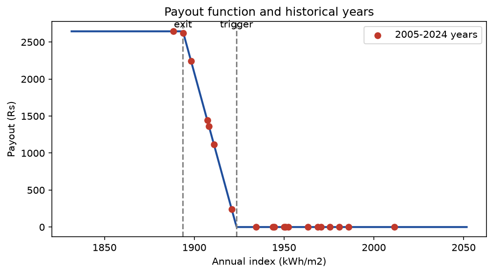
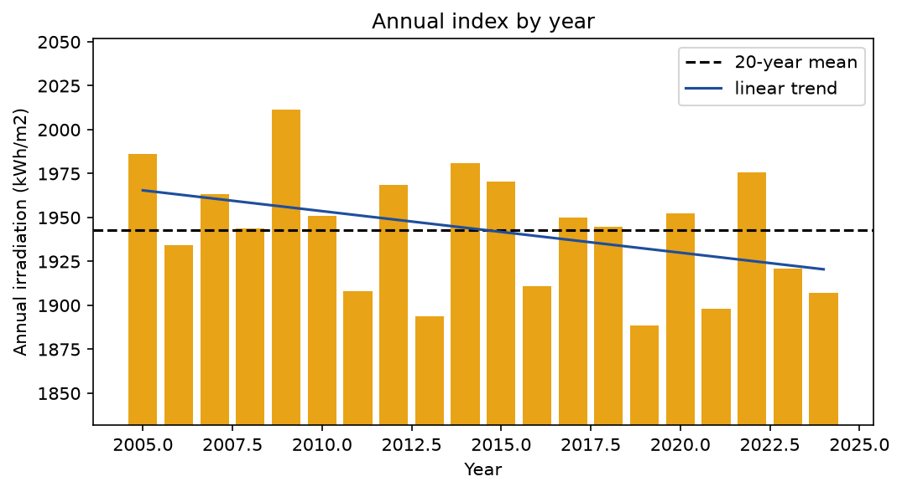
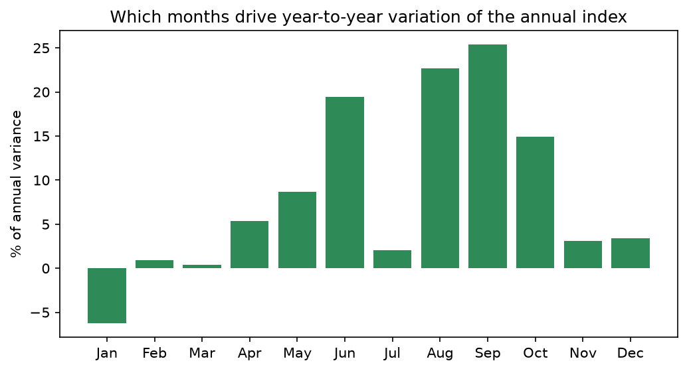
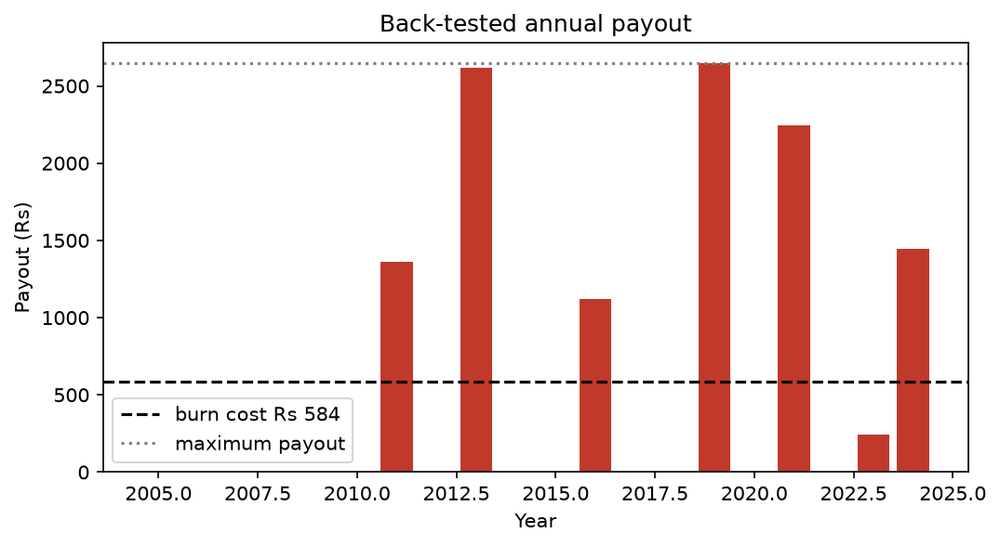
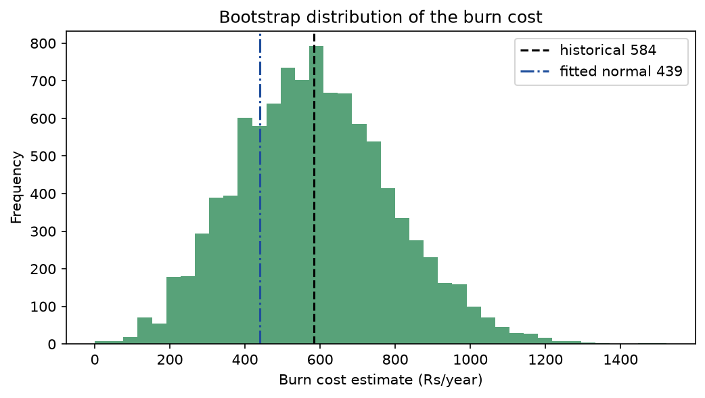
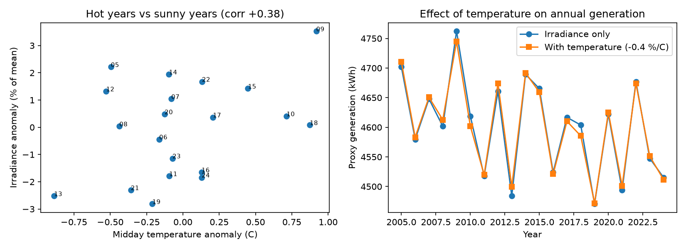
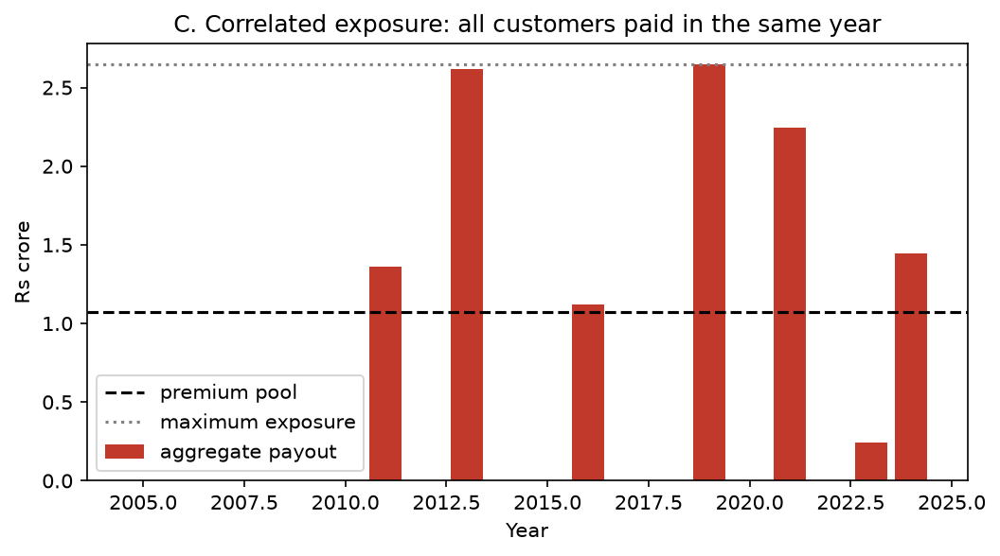

# Solar Yield Risk Pricing

**A weather-based insurance product for a rooftop solar system, designed, back-tested and priced with 20 years of satellite data.**

If a year turns out less sunny than normal, a solar owner earns less electricity savings. This project designs a simple insurance contract that pays out automatically when a measured sunlight number falls below an agreed level. It then tests the contract on 20 years of history and works out a fair price.

---

## The idea

**Parametric insurance** pays on a measured number, not on a claim you have to prove. Think of a flight-delay cover: if the flight is more than 3 hours late, you are paid, with no paperwork about what you lost.

Here in this problem, the measured number is the **total sunlight received in a year** (kWh per square metre). If it drops below a set **trigger**, the owner gets paid. The worse the year, the larger the payout, up to a **maximum**.

**The example system**
| | |
|---|---|
| Size | 3 kVA rooftop solar |
| Location | Ellisbridge, Ahmedabad (pincode 380006) |
| Expected output | 4,600 kWh per year |
| Electricity tariff | Rs 5.75 per kWh |
| Annual savings | Rs 26,450 |

---

## The final product

| Setting | Value | Plain meaning |
|---|---|---|
| Index | Yearly sunlight (kWh/m²) | The number we measure |
| Trigger | 1,923.6 kWh/m² (99% of the 20-year average) | Payouts start below this |
| Exit | 1,893.7 kWh/m² (5th percentile) | Maximum payout reached here |
| Maximum payout | Rs 2,645 (10% of annual savings) | The most anyone can receive |
| **Premium** | **Rs 1,070 per year** | About 4% of annual savings |



*The payout is zero above the trigger, rises in a straight line as the year gets worse, and stays flat at the maximum below the exit point.*

---

## What the data showed

Sunlight in Ahmedabad is very stable from year to year. The yearly total moves by only about **1.77%** around its average of 1,943 kWh/m².



Most of the year-to-year change comes from the **monsoon months (June to September)**, which explain ~70% of the variation.



**Design lesson.** My first design used a 95% trigger and a large payout. But the problem was that on real data it would have paid in **0 of 20 years**, because 95% is far below anything the area normally sees. I moved the trigger to 99% and cut the maximum payout, which gives a contract that pays about one year in three at a price of about 4% of savings.

---

## Back-test and pricing

I replayed the contract over 2005 to 2024 to see what it would have paid.

- Paid out in **7 of 20 years**
- Average **burn cost** (the average yearly payout) is **Rs 584**
- The price adds a safety margin on top: the higher of burn cost divided by 0.65, and burn cost plus half a standard deviation of payouts, giving **Rs 1,070**
- At this price, expected payouts are about **55%** of premiums collected



I also resampled the 20 years many times (bootstrap) to see how uncertain the burn cost is.



---

## Did temperature matter?

Hot panels produce a little less power, so I tested adding temperature. The year-to-year change in midday temperature is small (about 0.5 °C), so it moves yearly output by at most **0.4%**, against 1.8% for sunlight. No payout decision changed in any of the 20 years, so the index stays **sunlight only**: simpler to explain and verify.



---

## What could go wrong? A test on 10,000 customers

I imagined selling this to 10,000 customers and looked for weak spots.

| Problem | In simple words | What it would take to fix it |
|---|---|---|
| **Local mismatch (basis risk)** | The satellite sees a ~9 km square, but a rooftop may have shade or local cloud. Some customers lose money and get no payout. | Finer-resolution satellite data |
| **Non-weather losses** | Inverter faults, dirt on panels and shade cause about half of all lost savings, and the product pays none of it. | Trigger on measured generation from a smart meter |
| **Everyone is hit together** | All customers share the same weather, so a bad year hits everyone at once. In the worst year, payouts were about 2.5 times the premiums collected. | Stop-loss reinsurance |



---

## Limitations

- Only 20 years of data, so prices are uncertain.
- The satellite data is a model (reanalysis) with its own bias and a coarse grid.
- There is no real generation data, so output is assumed to scale with sunlight.
- The rooftop and non-weather assumptions in the customer test are my own, labelled estimates.

---

## How to run it

**1. Install the packages**
```
python -m pip install -r requirements.txt
```

**2. Run the analysis** (the data is already in `data/`)
```
python src/run_all.py
```
This prepares the data, studies the index, designs the product, back-tests and prices it, and runs the 10,000-customer test. Tables are saved to `outputs/` and charts to `figures/`.

**3. Run the temperature test**
```
python src/07_temperature_check.py
```

**Optional: download the data again.** `src/01_download.py` and `src/01b_download_temperature.py` fetch the satellite data. They need a free [Copernicus Climate Data Store](https://cds.climate.copernicus.eu) account with your key saved in `~/.cdsapirc`. Your key is never stored in this project.

---

## What is in this repo

```
src/       the Python scripts (numbered in the order they run) and config.py
data/      satellite data files (sunlight, rain, temperature)
outputs/   result tables, summaries and logs
figures/   all charts used above
```

All settings (trigger, payout cap, premium rules) live in one file, `src/config.py`, so you can change them and re-run to see how the price moves.

---

## Quick glossary

- **Index**: the measured number the contract is based on (yearly sunlight).
- **Trigger**: the level below which payouts start.
- **Exit**: the level at which the payout reaches its maximum.
- **Burn cost**: the average yearly payout the contract would have made in the past.
- **Premium**: the yearly price the customer pays.
- **Basis risk**: the gap between what the index pays and what the customer really lost.

---

## Data source

Sunlight, rainfall and temperature come from ERA5-Land reanalysis (2005 to 2024), produced by the Copernicus Climate Change Service (C3S) at ECMWF. Contains modified Copernicus Climate Change Service information.
